# Auditoría de Frecu frente al prototipo Portadora · 8 nov 2026

**Rama analizada:** `develop` en `a61f4dc`. La épica Portadora está cerrada (19 de 19 cortes).

**Método:**
- Las 26 pantallas del prototipo se capturaron a 390×844.
- La app se probó en dos iPhone simulados (iPhone 17 Pro como anfitrión e iPhone 17 como invitada, iOS 26.2).
- Se hicieron 5 revisiones de código en paralelo: fundamentos, primera vez y ajustes, inicio y unión, frecu activa, y lógica.

**Leyenda:** **[E]** = verificado en ejecución; **[C]** = encontrado leyendo el código.

## Resumen

- **Calidad estática:** `flutter analyze` no da avisos y `flutter test` pasa 582 de 582.
- **Fidelidad visual alta:**
  - Los tokens (colores, tipografía, radios, resortes), las fuentes, los 37 íconos y el movimiento reducido coinciden con el prototipo.
  - De los 26 estados, 15 son fieles o casi, 8 parciales y 3 faltan o difieren.
- **Funcionamiento:** todavía no sirve para una prueba real de voz. Hay 4 fallos críticos verificados en ejecución:
  - la voz no arranca en la primera frecu de cada sesión;
  - la sala entra sin participantes;
  - en iOS los permisos no se piden;
  - «Atrás» deja la frecu viva y bloquea crear otra.
- **Épica en curso:** `20261108-pendientes-portadora` (en implementación) no cubre ninguno de estos fallos. Además, su C4 (nivel real de voz con `getStats`) da por hecho que la malla WebRTC arranca.

## 1. Fallos de funcionamiento

| ID | Severidad | Qué pasa | Causa | Fuente |
|---|---|---|---|---|
| F1 | Crítica | En la primera frecu de cada sesión la voz no arranca: no se captura el micrófono, no hay offers ni `talk_state`, y el PTT muestra «al aire» sin enviar nada. En la segunda frecu de la misma sesión sí funciona (aparece el diálogo del micrófono y el anfitrión ve «Ana · hablando»). | `VoiceRepositoryImpl` se crea en `RoomPage` (`room_page.dart:181`) y se suscribe a la señalización (`voice_repository_impl.dart:30`) después de que `createRoom`/`joinRoom` consumieran el `welcome`, que va por un stream broadcast sin réplica (`signaling_client_datasource.dart:29-39`). Lo único que inicia WebRTC es `_handleWelcome` (`voice_repository_impl.dart:232-243`), y `initialize()` llama a `initializeAudio()` sin id (`voice_provider.dart:164`). | [E] |
| F2 | Crítica | La sala entra vacía: «En línea · 0/6», sin «tú» y sin «Eres el anfitrión». Se corrige solo cuando alguien entra o sale. Mientras tanto el anfitrión ve la hoja de salir de invitado y no ve la pantalla de cierre, y al cerrar la invitada ve «Personas 00». | `watchParticipants`/`watchStatus` son broadcast sin réplica (`room_repository_impl.dart:42-45, 76-80`) y emiten en `_onWelcome` (`:316-318`), antes de navegar. Los providers son autoDispose (`room_provider.dart:50-61`) y `host` se deduce de esa lista (`room_page.dart:189`). | [E] |
| F3 | Crítica (iOS) | En iOS, micrófono y notificaciones salen «negados» sin diálogo del sistema. `initializeAudio` devuelve `permissionDenied` en silencio y la bienvenida reaparece en cada arranque (incumple AC3 y D4). | `ios/Podfile` no define `GCC_PREPROCESSOR_DEFINITIONS` (`PERMISSION_MICROPHONE=1`, `PERMISSION_NOTIFICATIONS=1`, `PERMISSION_CAMERA=1`). En permission_handler_apple 9.6.5 esos permisos valen 0 y caen en `UnknownPermissionStrategy` (permanentlyDenied). Además, `_startVoice` ignora el `Result` (`room_page.dart:63`). | [E] |
| F4 | Alta | El gesto «atrás» de iOS o el botón Atrás de Android saca de la frecu sin cerrarla. Servidor, anuncio mDNS, servicio en primer plano y voz siguen vivos, y no hay forma de volver. Después, «Abrir frecu» no hace nada y no avisa hasta reiniciar la app (el servidor viejo rechaza el código nuevo). | `RoomPage` no tiene `PopScope` y `RoomRoute` es una ruta simple (`app_router.dart:26`). `start()` retorna temprano con el código anterior (`signaling_server_datasource.dart:72, 207`). | [E] |
| F5 | Alta | Al salir, el micrófono sigue capturando y las PeerConnections siguen abiertas. En la siguiente frecu se reutilizan PCs viejas, porque los ids `peer_N` se repiten, y el PTT puede dejar de controlar la pista enviada. | `leaveRoom` no toca la voz (`room_provider.dart:138-143`). PCs y pista solo se liberan en `dispose` de un provider keepAlive (`voice_repository_impl.dart:271-278`). Cada `welcome` pide otro `getUserMedia` (`peer_connection_datasource.dart:53-73`) y `_getOrCreatePeerConnection` reutiliza la PC existente (`:114-115`). | [C] |
| F6 | Alta | La reconexión abre un bucle por cada desconexión, así que puede unirse varias veces. Un bucle agotado emite `closed('host_unreachable')` aunque otro ya haya reconectado, y una unión por IP fallida deja bucles vivos. | No hay guarda en `room_repository_impl.dart:180-230`. `connect()` asigna el canal antes de `ready` (`signaling_client_datasource.dart:46-50, 142-147`). | [C] |
| F7 | Alta | Las frecus cerradas siguen en «Frecus cercanas» y unirse a ellas falla. Su nota además desplaza la de la siguiente frecu: se abrió en Si♭4 en vez de Mi♭4. Una frecu nueva con el mismo nombre no apareció en el otro teléfono. | Nadie llama a `StopPublishingRoom` (`discovery_usecases.dart:59-66`). El anuncio sigue hasta publicar otra frecu: según el log, el servidor se detuvo a las 09:48:22 y el anuncio se retiró a las 09:52:04. El evento `lost` se ignora porque `_buildNearbyRoom` exige host y puerto (`mdns_datasource.dart:138-141, 161-170`). | [E] |
| F8 | Alta | Al conectar por IP a una dirección sin anfitrión, la hoja queda bloqueada entre 75 y 100 s sin poder cerrarse. Termina en «Error inesperado» y no en «El anfitrión no responde», y el campo IP no se marca. | `connect` espera `ready` sin límite de tiempo (`signaling_client_datasource.dart:49-50`). `joinRoom` convierte la excepción en `Failure.unexpected` (`room_repository_impl.dart:174-176`). La hoja bloquea el cierre mientras conecta (`ip_join_sheet.dart:93-94`). | [E] |
| F9 | Media | Quien se une ve «Frecu» como título en lugar del nombre real, también en la notificación. | `joinRoom` fija `'Frecu'` (`room_repository_impl.dart:153, 159-164`) y el `welcome` no trae el nombre. | [E] |
| F10 | Media | Con datos móviles activos nunca se ve el estado «sin red» (1.2). La IP del QR podría ser la del celular. | Se toma la primera IPv4 no loopback de cualquier interfaz (`network_repository_impl.dart:78-89`, `room_repository_impl.dart:83-98`, con `192.168.43.1` como respaldo). | [C] |
| F11 | Media (Android) | Si se niega cualquier permiso, la bienvenida se reabre en cada arranque. | `needs_onboarding_provider.dart:17-20` y `onboarding_permissions_provider.dart:137-149` tratan `denied` como pendiente. permission_handler_android documenta que consultar el estado nunca devuelve `permanentlyDenied` (`PermissionManager.java:300-310`). La prueba `first_open_test` usa un falso que sí lo devuelve. | [C] |
| F12 | Media | El servidor de señalización no controla el acceso. Enruta offer, answer, ice y `talk_state` de sockets que no hicieron `join`, no verifica `from`, ignora la versión y no limita los intentos del código. Cualquiera en la red puede falsear «hablando» o romper enlaces. | `signaling_server_datasource.dart:166-178`. | [C] |
| F13 | Media | Al conectar audífonos la salida no cambia sola (lo pide `docs/audio.md`). La pastilla y el aviso de eco pueden decir «Altavoz» con el audio en Bluetooth. | Solo se actualizan las rutas disponibles (`voice_repository_impl.dart:192-212`). | [C] |
| F14 | Media | La nota nunca viaja en el `welcome`, así que quien se une por IP no ve la nota. | `createRoom` no pasa `note` al repositorio (`room_provider.dart:90-101`) y `joinRoom` pisa la nota con la de la invitación (`:129`). **Conocido (P64); lo cubre la épica de pendientes (C3).** | [C] |
| F15 | Media | En micrófono abierto, «hablando» es binario y no se apaga: la isla queda fija en «Ana · hablando». Elegir «Abierto» deja el micrófono en silencio, y al reconectar no se silencia. | `talk_state` se emite al abrir el micrófono (`peer_connection_datasource.dart:81-89`). `setTalkMode` no transmite (`voice_repository_impl.dart:123-136`). El nivel es simulado con `frVoice` (P102, que la épica cubre en parte). | [C] |
| F16 | Baja | Errores que se pierden y textos fuera de slang. | `_startVoice`, `startDiscovery().ignore()` y `publishRoom` sin esperar resultado. Futures de offer/answer/ice sin capturar, y candidatos ICE previos a la PC que se borran (por confirmar). Textos fijos: `'Frecu'`, `'Anfitrión'`, `'Participante'`; notificación del servicio en primer plano y `Info.plist` solo en español. | [C] |
| F17 | Baja | La tarjeta y las invitaciones reenviadas muestran el nombre de host `.local` («MacBook-Pro-…local») y no la IP. Falta confirmar que Android lo resuelva. | `_extractHost` prefiere `service.host` a `addresses` (`mdns_datasource.dart:116-123`). | [E] |

**Registro en la memoria de Specty:**

| Hallazgo | Pendiente |
|---|---|
| F1 | P118 |
| F2 | P119 |
| F3 | P120 |
| F4 | P121 |
| F5 | P122 |
| F6 | P124 |
| F7 y F17 | P137 |
| F8 | P125 |
| F9 | P126 |
| F10 | P127 |
| F11 | P128 |
| F12 | P129 |
| F13 | P130 |
| F15 | P131 |
| F16 | P136 |
| D8 de día | P132 |
| Doble borde de `FrField` | P133 |
| Textos cortados y mayúsculas | P134 |
| Detalles de fidelidad | P135 |

**Lo que sí funciona en ejecución:**
- Descubrimiento mDNS entre teléfonos, con el pico en la tecla correcta del sintonizador.
- Código validado contra el anfitrión, con sacudida y el aviso en rojo.
- Nota de la hora: a las 09:39 da Mi♭4, 311,1 Hz (AC4).
- Invitación con QR.
- Hojas de salida de audio y de cierre.
- Pantalla «Fin de la transmisión» en ambos lados.
- Cambio de tema instantáneo y persistente (AC1).
- Recepción de «Ana · hablando» cuando la voz sí arranca.

## 2. Fidelidad con el prototipo: los 26 estados

| Estado | Veredicto | Diferencias |
|---|---|---|
| 0.0 Arranque | **Falta** | No hay intro de la portadora. El splash nativo es el de la plantilla: en iOS, fondo blanco; en Android, ícono de Flutter. Conocido (P69/P71). |
| 0.1 Bienvenida | Fiel | De día, la firma de «tú» va en lima (D8). |
| 0.2 Nombre y firma | Casi fiel | El campo tiene un doble borde. El contador va fuera del campo. De día, la firma va en lima (D8). |
| 0.3 Permisos | Parcial | El diseño es fiel. En iOS salen negados sin diálogo (F3). En Android hay bucle (F11). |
| 1.0 Inicio con frecus | Casi fiel | Muestra el nombre de host en vez de la IP (F17). «Frecus cercanas» va sin mayúsculas. La marca es la firma de «frecu» (curva 4:5), no la marca 2:3 (`components.js:142`). Quedan frecus fantasma (F7). |
| 1.1 Escaneando | Fiel | — |
| 1.2 Sin red | Parcial | Falta «Abrir ajustes de Wi-Fi» (P83/P86). No se detecta con datos móviles (F10). |
| 1.3 Código de acceso | Fiel | La cabecera se parte en dos líneas con el nombre de host. |
| 1.4 Código incorrecto | Fiel | Falta la vibración (`HapticFeedback`). |
| 1.5 Conectar por IP | **Difiere** | Bloqueo de 75–100 s y «Error inesperado» (F8). No valida la IP. «Puerto 47800» va bajo el campo. Íconos de Material (P96). |
| 1.6 Escanear QR | Fiel | Pide la cámara en contexto. Si se niega no hay estado propio (P97). |
| 1.7 QR detectado | Parcial | La tarjeta no trae el nombre de la frecu (P98). |
| 2.0 Prepara la red | Fiel | La pestaña inicial sigue al teléfono (iPhone en iOS); el prototipo prioriza Android. |
| 2.1 Nueva frecu | Fiel | La nota se calcula bien, pero las frecus fantasma la desplazan (F7). |
| 2.2 Anfitrión solo | Parcial | El diseño es fiel (se ve tras un evento), pero al abrir la frecu sale vacía (F2). |
| 2.3 Invitar | Fiel | Ojos del QR cuadrados (P110). |
| 3.0 Conectando | **Falta** | `RoomStatus.connecting` nunca se emite. |
| 3.1 En línea | Parcial | La invitada ve la malla vacía y el título «Frecu» (F2, F9). El orden de los lugares es distinto: en el prototipo el primero en llegar va arriba. «Libre» sin mayúsculas. «ABIERTO» sale cortado como «ABIER…». |
| 3.2 Ana habla | Fiel* | *Solo a partir de la segunda frecu de la sesión (F1). El nivel es simulado (P102). |
| 3.3 Tú transmites | Fiel* | *Lo visual es fiel (núcleo, cronómetro, isla), pero en la primera frecu no envía audio (F1) y en iOS no tiene micrófono (F3). |
| 3.4 Micrófono abierto | Parcial | F15. Aviso de eco con ícono de Material (P108). No se probó en ejecución. |
| 3.5 Reconectando | Parcial | Sin cuenta atrás (P101/P105). Bucles de reconexión (F6). No se probó en ejecución. |
| 3.6 Salida de audio | Fiel | Sin nombre del Bluetooth (P111). No cambia sola (F13). |
| 3.7 Cerrar la frecu | Parcial | Al abrir la frecu, el anfitrión ve la hoja de invitado (F2). El botón no es sólido (P109). |
| 4.0 Fin de la transmisión | Fiel | La invitada ve «Personas 00» (F2). |
| 4.1 Ajustes | Parcial | Falta el grupo «General» (P62) y hay íconos de Material (P61); los dos están en la épica de pendientes. «OSCURO» sale cortado como «OSCU…». El pie va sin versión ni mayúsculas. De día, la firma va en lima (D8). |

### Capturas lado a lado

Las capturas del prototipo están en `auditoria-2026-11-08/prototipo/` y las de la app en `auditoria-2026-11-08/app/`.

| Prototipo | App | Nota |
|---|---|---|
| 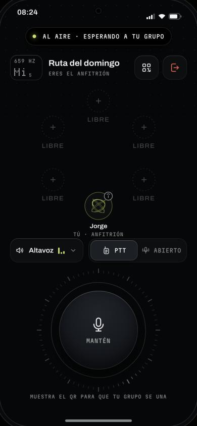 | 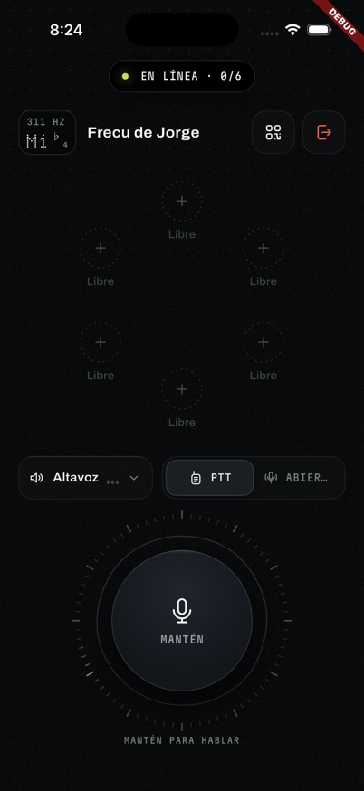 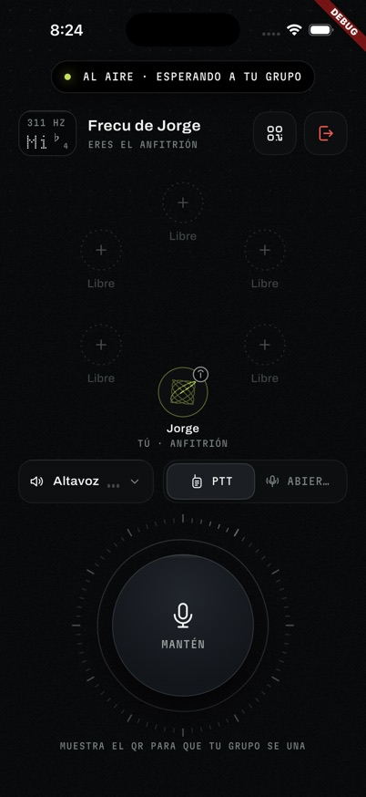 | F2: al abrir la frecu (izquierda) y tras entrar y salir alguien (derecha). |
| 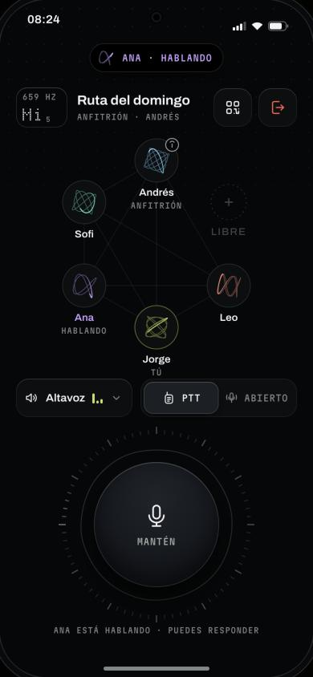 | 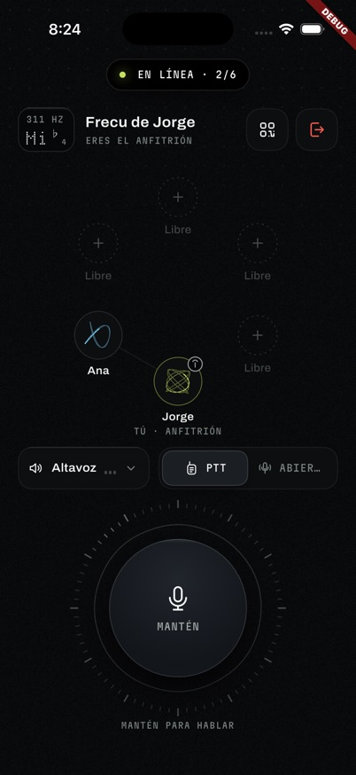 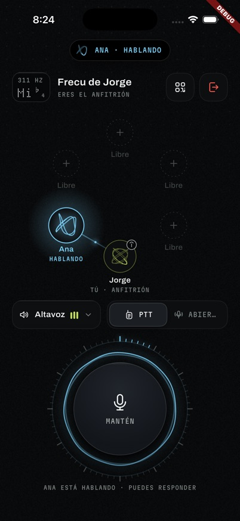 | F1: Ana transmite en la primera frecu (izquierda) y en la segunda (derecha). |
| 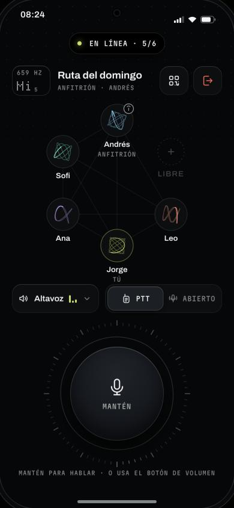 | 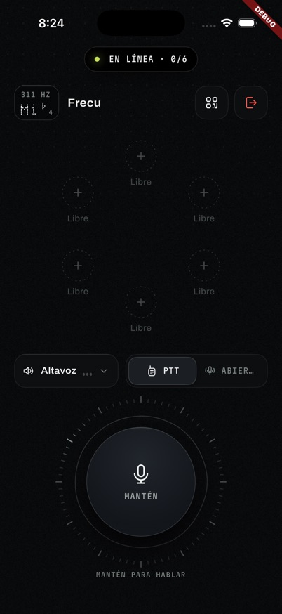 | F2 y F9: vista de la invitada. |
| 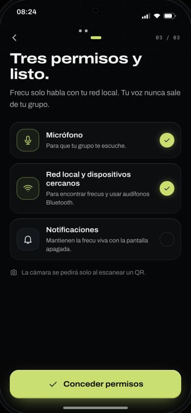 | 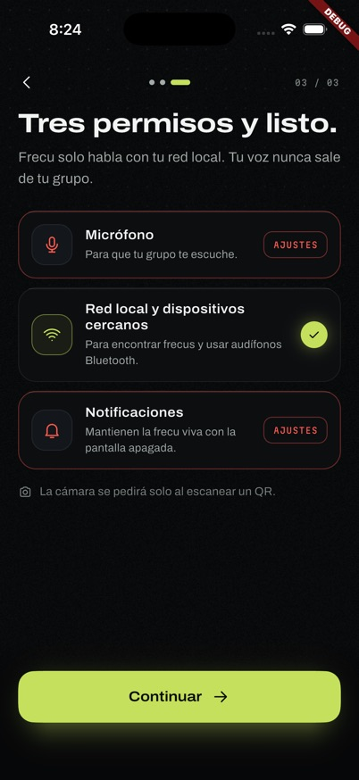 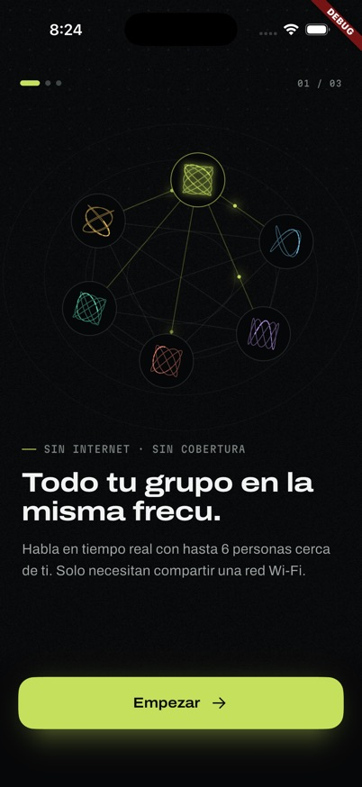 | F3: iOS no muestra el diálogo y la bienvenida vuelve en cada arranque. |
| 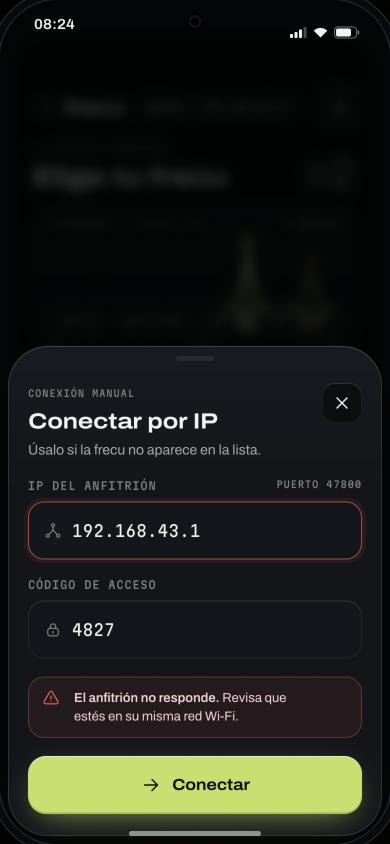 | 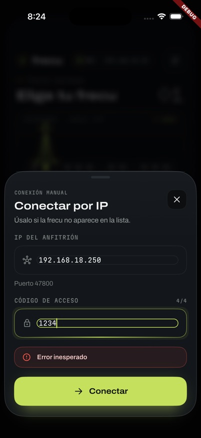 | F8. |
| 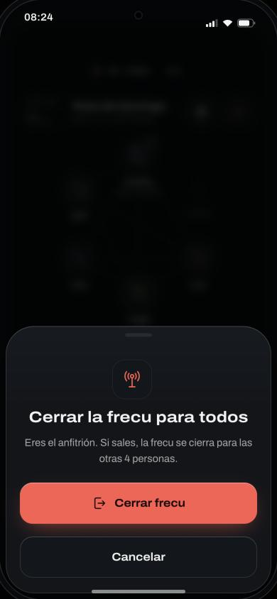 | 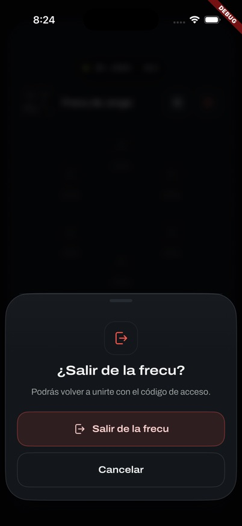 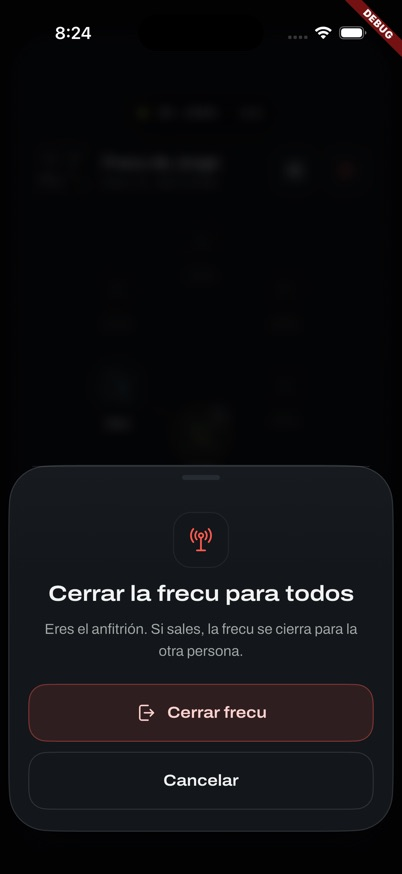 | F2: al abrir la frecu (izquierda) y tras un evento (derecha). |
| 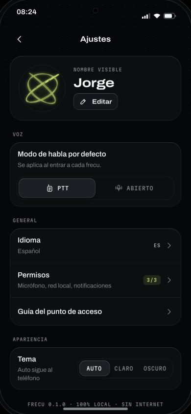 | 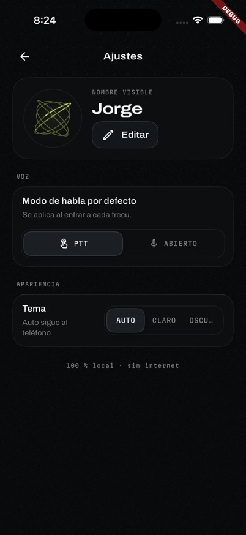 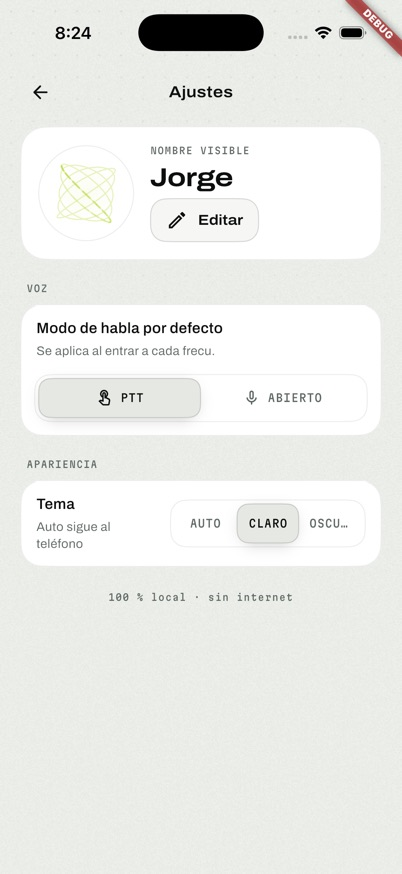 | Grupo «General», «OSCU…» y firma lima de día (D8). |
| 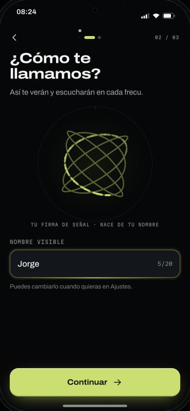 | 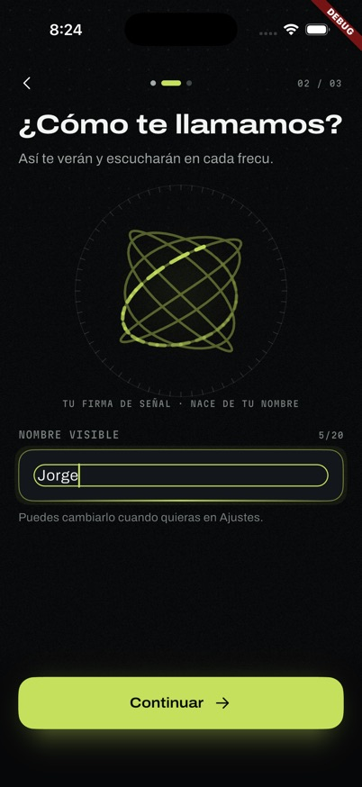 | Doble borde del campo. |
| 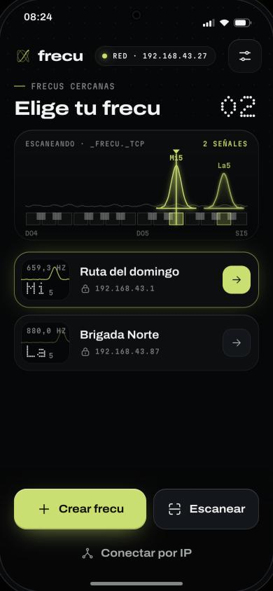 | 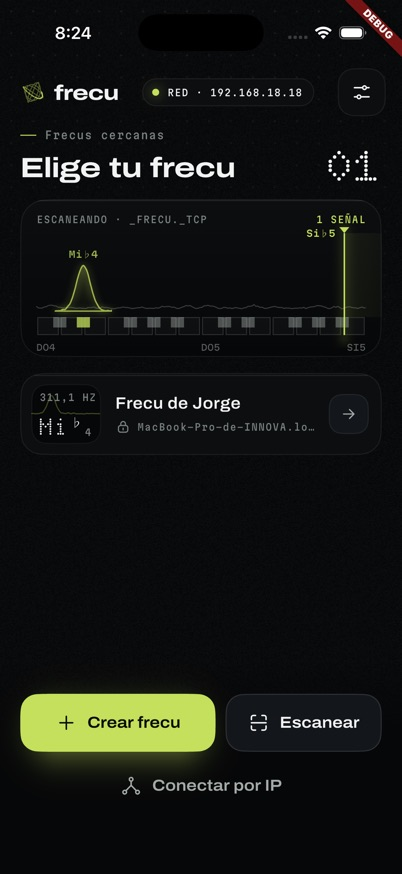 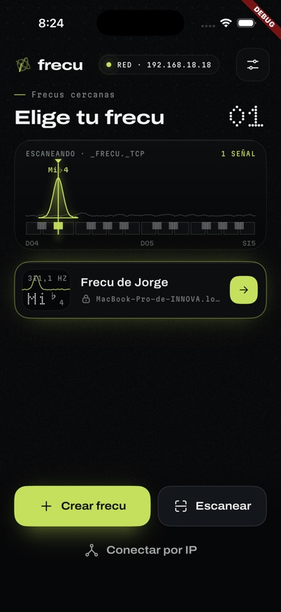 | F17 y F7. |
| 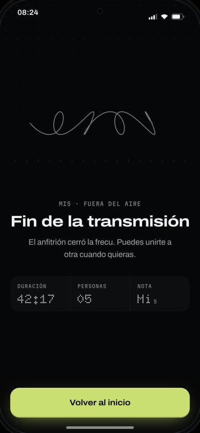 | 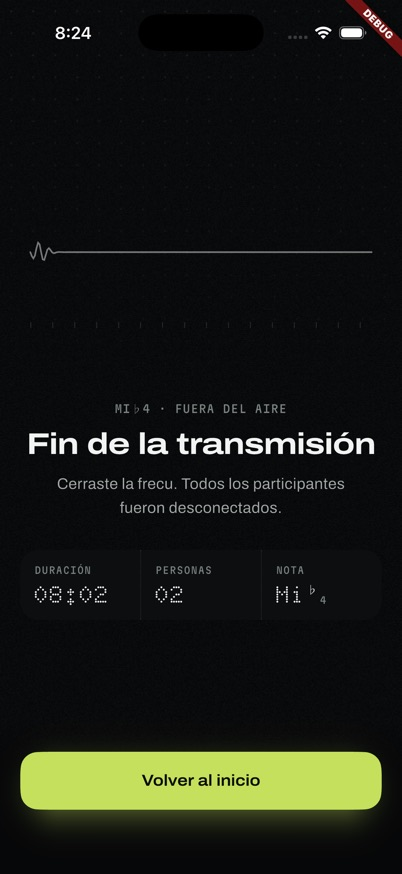  | Cierre fiel; «Personas 00» en la invitada. |

El resto de pares (bienvenida, código, punto de acceso, nueva frecu, invitar, transmitir, salida de audio) están en las mismas carpetas y son fieles.

## 3. Sistema de diseño

**Fiel al prototipo:**
- Colores de ambos temas con los mismos hex y alfas (`fr_colors.dart` frente a `base.css`).
- Escala tipográfica completa: tamaño, interlineado, tracking y ejes `wdth`/`wght`/`ROND`.
- Radios, resortes (600/0,62, 220/0,9 y 160/0,5) y curvas.
- Fuentes Archivo, Martian Mono y Doto como assets OFL, sin `google_fonts`.
- Los 37 íconos con las mismas formas.
- Retícula y grano.
- Isla siempre oscura (D5).
- Movimiento reducido: congela los bucles y pasa a fundidos.
- Hoja elástica.

**Desviaciones:**
- **D8 incumplida.** De día, `SignalSignature`, `WaveLoader` y la carga de `FrButton` secundario y fantasma pintan con `signal` (lima) en lugar de `signalFg` (tinta) con halo verde (`signal_signature.dart:135, 242-248`; `wave_loader.dart:36`; `fr_button.dart:152, 159`). Por eso la firma casi no se ve sobre papel. [E]
- **Doble borde en todos los `FrField`.** El `inputDecorationTheme` de `AppTheme` (`enabledBorder`/`focusedBorder`, en `app_theme.dart:133-163`) se cuela en `InputDecoration.collapsed` (`fr_field.dart:255`). Pasa en los campos de nombre, nueva frecu, IP y código. [E]
- **Transiciones sin conectar al router.** Onda, deslizamiento y expansión existen, pero las rutas son `AutoRoute` (`app_router.dart:16-28`). Conocido (P53) y fuera de la épica de pendientes.
- **Textos cortados en 402 pt:** «ABIER…» en el selector de modo de la frecu y «OSCU…» en el selector de tema. [E]
- **Etiquetas sin mayúsculas:** «Frecus cercanas», «Libre» y el pie de Ajustes.
- **Contraste de día por debajo de 4,5:1:** `alert` sobre `bg0` da 4,26:1 (error de `FrField`) y `warn` sobre su lavado da 4,01:1 (`FrTag`). La prueba de R4 no cubre los colores de estado.
- **Otras diferencias menores:**
  - falta la vibración en código incorrecto;
  - `FrButton` no tiene `danger-solid` (P109);
  - hay íconos de Material en core (P52/P55/P96, en la épica de pendientes);
  - el título de `FrSheet` es 24/650 en vez de 22/680;
  - el texto mono de `FrField` es de 13 px en vez de 16;
  - el marcatexto de día solo se usa en la guía;
  - `FrSpace` no se usa;
  - las fuentes van con todos sus ejes, unos 1,26 MB (R3, P35).

## 4. Relación con la épica en curso

La épica `20261108-pendientes-portadora`, que otra sesión está implementando, cubre:
- nivel real de voz (C4);
- nota coherente, incluida la unión por IP (C3, que corresponde a F14);
- íconos propios (C1, C2, C5 y C6);
- grupo «General» (C6 y C7);
- mantenimiento.

No cubre:
- los fallos F1 a F13, F16 y F17 (F15 solo en parte);
- D8 y el doble borde;
- los textos cortados;
- las transiciones (P53);
- el arranque (P69).

**Riesgo:** sus cortes tocan los mismos archivos que habría que corregir (`voice_repository_impl.dart`, `peer_connection_datasource.dart` y `room_page.dart`), y su C4 mide `getStats()` sobre una malla que en la primera frecu no existe. Conviene corregir F1 a F5 antes de su C4, o sumarlos como cortes de esa épica.

## 5. Por qué pasan los 582 tests

- Las pruebas de presentación simulan los streams con `Stream.value`, que repite el valor, y eso oculta F2 (`room_flow_test.dart:107-110`).
- Ninguna prueba crea `VoiceNotifier` después del `welcome`, que es lo que provoca F1.
- `platform_manifest_test` no revisa las macros del Podfile (F3).
- `first_open_test` usa un falso que devuelve `permanentlyDenied`, cosa que Android nunca hace (F11).
- No hay pruebas de:
  - Atrás en `RoomPage` (F4);
  - retirar el anuncio al cerrar (F7);
  - reconexión con fallos (F6);
  - límite de tiempo al conectar (F8).
- No hay pruebas de imagen (goldens), así que el doble borde, los textos cortados y D8 pasan sin detectarse.

## 6. Orden recomendado

1. **Corrección de cableado:**
   - **F1 y F2:** crear la voz y la sala antes del `welcome`, o que sus streams repitan el último valor; pasar el id local al iniciar la voz.
   - **F3:** macros `PERMISSION_*` en el Podfile.
   - **F4:** `PopScope` con la hoja de salir, y salir de la frecu al desmontar `RoomPage`.
   - **F7:** retirar el anuncio al cerrar y tratar `lost` por nombre de servicio.
   - **Pruebas:** de integración que reproduzcan el orden real (unirse y luego abrir la sala).
2. **Robustez:**
   - F5: liberar PCs y pista al salir;
   - F6: un solo bucle de reconexión;
   - F8: límite de tiempo y `hostUnreachable`;
   - F9: nombre de la frecu en el `welcome`;
   - F10 y F11.
3. **Visual rápido:** D8 en firmas y cargas, doble borde de `FrField`, textos cortados y mayúsculas.
4. **Después:** lo que ya cubre la épica de pendientes. Luego las transiciones (P53), el arranque (P69) y los eventos de la isla (P101).
5. **Validación final:** prueba en dos teléfonos reales, con un Android como anfitrión, antes de dar el MVP por cerrado.

## 7. Estado tras las correcciones (8 nov 2026, tarde)

**Rama:** `fix/auditoria-portadora`, en `.worktrees/fix-auditoria`, sobre `develop` `e593bd0` (incluye la nota coherente de la otra épica). Sin commit.

**Calidad:** `flutter analyze` sin avisos, `flutter test` con 823 de 823, `dart format` limpio en `lib` y `test`, y la app compila para el simulador de iOS.

**Verificación en ejecución:** dos iPhone simulados desde una instalación limpia. Capturas en `auditoria-2026-11-08/app-corregida/`.

**Leyenda:** **[E]** = verificado en ejecución; **[P]** = corregido y cubierto por pruebas, sin verificar en ejecución; **[O]** = lo cubre la épica «Pendientes de Portadora».

### Funcionamiento

| Hallazgo | Estado | Cómo quedó |
|---|---|---|
| F1 Voz en la primera frecu | Corregido [E] | La voz se crea antes de crear o unirse y entra a la malla con el id local. En la primera frecu de la sesión el anfitrión ve «Ana · hablando». |
| F2 Sala vacía al entrar | Corregido [E] | Los streams entregan primero el valor actual. Se ven «tú», «Eres el anfitrión», 2/6 y «Personas 02» en el cierre. |
| F3 Permisos en iOS | Corregido [E] | Macros `PERMISSION_*` en el Podfile. iOS muestra sus diálogos y la app ya no vuelve a la bienvenida. |
| F4 Atrás | Corregido [E] | `PopScope` en la sala: el gesto no saca de la frecu y Atrás abre la hoja de salir. Si la pantalla se desmonta, sale de la frecu. Crear con un servidor vivo lo reinicia. |
| F5 Liberar la voz al salir | Corregido [E] | Salir cierra enlaces, pista y sesión de audio. Tras salir y volver, la voz sigue funcionando. |
| F6 Reconexión | Corregido [P] | Un solo bucle por sesión, cierre definitivo al rendirse y sin bucles tras una unión fallida. |
| F7 Frecus fantasma | Corregido [E] | Se retira el anuncio al cerrar, `lost` se resuelve por nombre de servicio y la búsqueda se pausa en la sala. Tras cerrar, la lista queda vacía. |
| F8 Conexión por IP | Corregido [E] | Límite de 5 s, error diseñado «El anfitrión no responde», validación de IPv4 y hoja que se puede cerrar mientras conecta. |
| F9 Nombre al unirse | Corregido [E] | `roomName` en el `welcome` y `name` en el QR, ambos aditivos. |
| F10 «Sin red» con datos móviles | Corregido [P] | Solo cuentan interfaces Wi-Fi o de punto de acceso (`lib/core/network/lan_address.dart`), también para la IP del anfitrión. |
| F11 Bienvenida repetida | Corregido [E en iOS] | La marca `onboarding.completed` decide la primera apertura. |
| F12 Control de acceso | Corregido [P] | Nada se enruta antes del `join`, el remitente es el del socket, se rechaza otra versión (`Failure.versionMismatch`) y hay bloqueo tras 5 códigos erróneos. |
| F13 Ruta de audio | Corregido [P] | Cambia sola al conectar audífonos y muestra el nombre del Bluetooth. |
| F14 Nota al unirse por IP | [O], ya en `develop` [E] | — |
| F15 Micrófono abierto | Corregido [E] | «Abierto» abre al instante y «Silenciado» llega a la malla. El nivel real (`getStats`) es [O] C4. |
| F16 Errores y textos | Corregido [P] | Aviso de micrófono con «Abrir ajustes», ICE tempranos, textos a slang, `InfoPlist.strings` es/en y botón «Salir» en la notificación de Android. |
| F17 IP en vez de `.local` | Corregido [E] | — |

### Diseño

| Hallazgo | Estado |
|---|---|
| D8 de día | Corregido [E]: firma y cargas en tinta con halo verde, igual que el prototipo. Además, `FrMarkText` (marcatexto) se usa en «N señales» y «Código correcto». |
| Doble borde de `FrField` | Corregido [E]; también el contador dentro de la caja y el texto de 16/500. |
| Textos cortados y mayúsculas | Corregido [E]: «ABIERTO», «OSCURO», «FRECUS CERCANAS», «LIBRE» y el pie con la versión. |
| Contraste de día | Corregido [P]: `alertFg`/`warnFg`, y la prueba R4 cubre los colores de estado. |
| Transiciones (P53) | Corregido [E]: onda, deslizamiento, expansión al acertar el código y gesto de volver desde el borde en iOS. |
| Arranque (P69) | Corregido [E]: intro de la portadora, splash nativo oscuro e íconos con la marca. |
| Marca 2:3 | Corregido [E]. |
| `danger-solid` (P109) | Corregido [E]. |
| Ojos del QR (P110) | Corregido [E]. |
| Isla: eventos y cuenta atrás (P101/P105) | Corregido: eventos [E], cuenta atrás [P]. |
| «Conectando» (3.0) | Corregido [P], con el estado ICE por enlace. |
| Orden de la malla y «Silenciado» | Corregido [E]. |
| Escáner sin cámara (P97) | Corregido [E]. |
| Nombre en el QR (P98) | Corregido [P]. |
| Abrir ajustes de Wi-Fi y de zona Wi-Fi | Corregido [P] con `app_settings` 6.1.1. Las 8.x y 9.x solo admiten Swift Package Manager y el proyecto usa CocoaPods. |
| Guía que empieza en Android | Corregido [E]. |
| Vibración con código incorrecto y detalles de componentes | Corregido [P]. |

### Lo que queda

- **[O] Épica de pendientes:** íconos de Material (Ajustes y hojas de unión), grupo «General» y nivel real de voz.
- **Recorte de los ejes de las fuentes (R3/P35):** es una optimización de tamaño; primero hay que medir el APK.
- **Rendimiento en gama media (R1):** requiere un teléfono real.
- **`FrSpace` sin uso y `PermissionsGuard` sin función (P80):** deuda menor.
- **Observación nueva:** si el proceso del anfitrión queda congelado más de 15 s (pasó con el Mac dormido), corta su propio enlace con el servidor y no lo recupera. Hay que comprobar en un teléfono real si iOS o Android llegan a suspenderlo en segundo plano.

## Límites de esta auditoría

No se verificó:
- Android: no había emulador.
- Audio audible: los dos simuladores comparten el micrófono del Mac.
- Bluetooth.
- Reconexión real.
- Pantalla apagada con el servicio en primer plano.
- Movimiento reducido en ejecución.
- Tema claro en todas las pantallas.
- Rendimiento en un teléfono de gama media.
